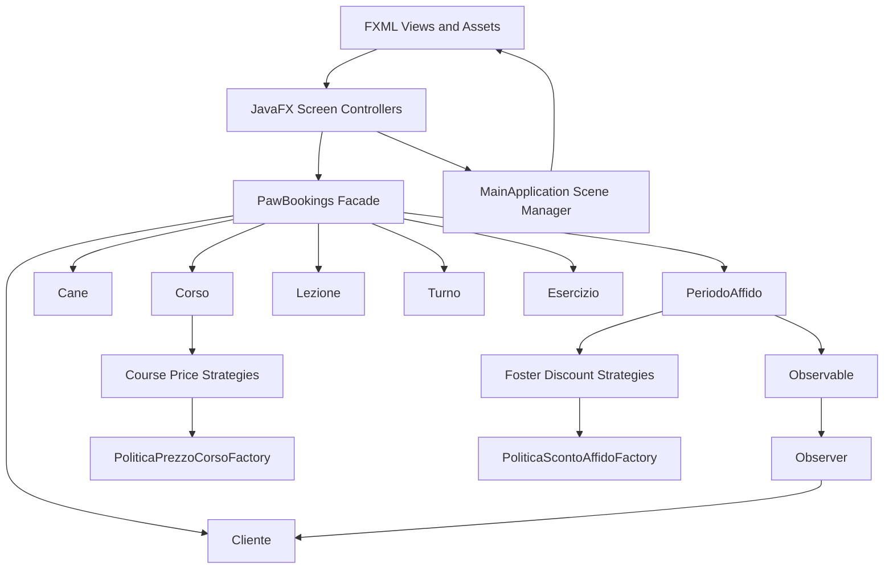
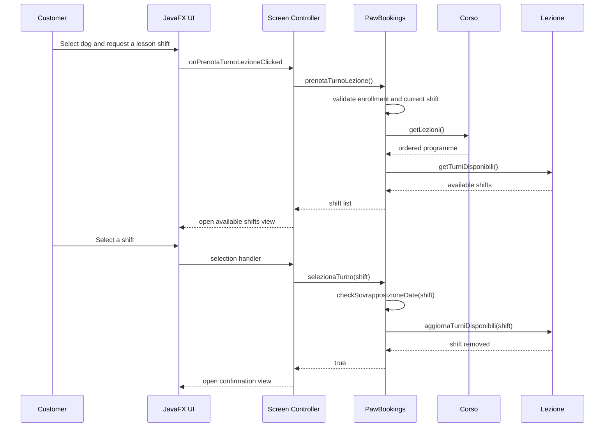
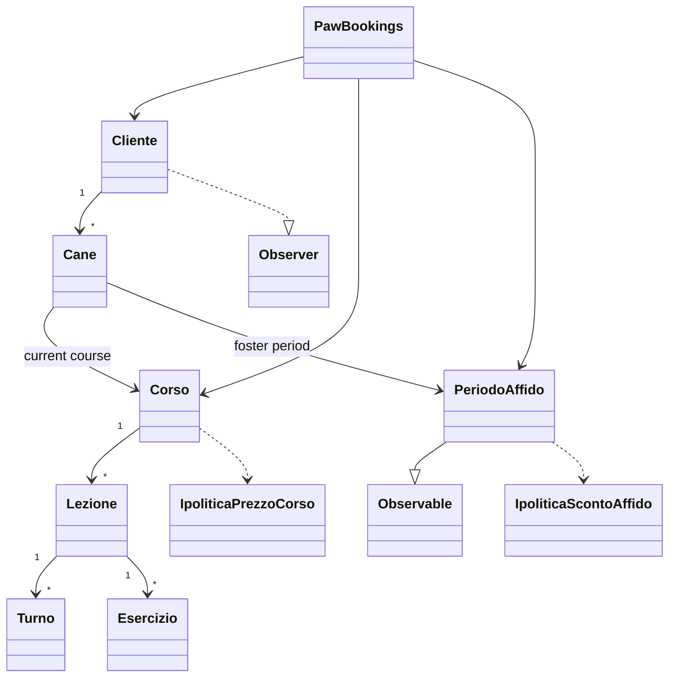

# PawBookings

PawBookings is a JavaFX desktop and mobile-style application for managing a dog
training centre. It covers course enrollment, lesson and shift booking, foster
care, health-status notifications, and configurable pricing rules.

The project is an academic software engineering case study built around a
domain-driven core and a layered JavaFX presentation. The runtime keeps all data
in memory; demo customers, dogs, courses, lessons, and shifts are created at
startup so the application can be evaluated without external services.

<p align="center">
  
</p>

## Key Features

- Customer registration, authentication, and dog management.
- Course catalogue with capacity control and progression rules.
- Lesson programmes composed of exercises.
- Shift booking, cancellation, exchange, and make-up lesson recovery.
- Foster-care periods with capacity tracking and pickup flows.
- Observer-based health-status notifications for customers with dogs in care.
- Strategy, factory, and composite pricing policies for courses and foster care.
- Separate customer and administrator areas with dedicated FXML views.
- JUnit 5 test suite covering use cases, alternative flows, and domain rules.

## System Architecture

The application is split into a domain layer, a JavaFX presentation layer, and a
test layer. The domain layer is independent of JavaFX and exposes a single
`PawBookings` facade, implemented as a GoF Singleton, to the screen controllers.
Controllers only coordinate view state and delegate business operations to the
facade.

### High-Level Components

- `domain_layer` contains the entities (`Cane`, `Cliente`, `Corso`, `Lezione`,
  `Turno`, `Esercizio`, `PeriodoAffido`), the `PawBookings` application service,
  the `Observable`/`Observer` notification mechanism, and the pricing policy
  packages.
- `org.sample.pawbookings` contains the JavaFX entry point and one controller
  per screen. Controllers load FXML documents and navigate through a scene-root
  stack.
- `src/main/resources/org/sample/pawbookings` contains the FXML view definitions.
- `src/main/resources/assets` contains the images used by the views.
- `src/test/java/com/example` contains the JUnit 5 integration and unit tests.

### Architecture Diagram



### Shift Booking Flow



### Domain Model



### Repository Layout

```text
PawBookings/
├── README.md                         # Project documentation
├── IDEAZIONE/                        # Requirements, vision, glossary, use cases
│   ├── Documento di visione.pdf
│   ├── Glossario.pdf
│   ├── Modello dei casi d'uso.pdf
│   └── Regole di dominio.pdf
├── ELABORAZIONE/                     # Iteration reports and execution screenshot
│   ├── ITERAZIONE 1/ ... ITERAZIONE 5/
│   └── istruzione esecuzione software.png
└── pawbookings/                      # Maven project
    ├── pom.xml                       # Dependencies and JavaFX plugin configuration
    ├── mvnw                          # Maven wrapper script
    ├── mvnw.cmd                      # Maven wrapper script for Windows
    └── src/
        ├── main/
        │   ├── java/
        │   │   ├── module-info.java  # Java module descriptor
        │   │   ├── domain_layer/     # Entities, facade, policies, observer pattern
        │   │   └── org/sample/pawbookings/
        │   │       ├── MainApplication.java
        │   │       └── *Controller.java
        │   └── resources/
        │       ├── org/sample/pawbookings/*.fxml
        │       └── assets/           # UI images
        └── test/
            └── java/com/example/     # JUnit 5 tests
```

### Design Patterns

- **Singleton**: `PawBookings`, `PoliticaPrezzoCorsoFactory`, and
  `PoliticaScontoAffidoFactory` expose a single instance.
- **Facade**: `PawBookings` centralises domain operations for the controllers.
- **Observer**: `PeriodoAffido` extends `Observable`; `Cliente` implements
  `Observer` to receive health-status updates.
- **Strategy**: `IpoliticaPrezzoCorso` and `IpoliticaScontoAffido` define
  interchangeable pricing algorithms.
- **Factory**: the two policy factories create strategies from a policy name.
- **Composite**: `PoliticaComposta` and `PoliticaScontoAffidoComposta` combine
  multiple strategies, allowing overlapping domain rules to be applied.
- **MVC-style separation**: FXML views, JavaFX controllers, and the domain
  facade are kept separate.

## Prerequisites

- **JDK 21** (the Maven compiler and JavaFX dependencies target Java 21).
- **Maven 3.8 or newer**. The repository includes `mvnw`/`mvnw.cmd`, but the
  `.mvn/wrapper` configuration is not included in this checkout; use a local
  Maven installation unless your environment provides that configuration.
- A desktop environment supported by JavaFX (macOS, Windows, or Linux).
- Internet access on the first build to download Maven dependencies.

No external database, application server, or JavaFX SDK installation is
required. OpenJFX artifacts are resolved by Maven.

Verify the local toolchain:

```bash
java -version
mvn -version
```

## Installation

Clone the repository and enter the Maven project:

```bash
git clone https://github.com/Prv2106/PawBookings.git
cd PawBookings/pawbookings
```

Build the project and run the tests:

```bash
mvn clean install
mvn test
```

On Windows, use `mvn` from a local Maven installation. If your checkout
includes the `.mvn/wrapper` directory, `./mvnw` or `mvnw.cmd` can be used as a
drop-in replacement for `mvn`.

## Configuration

PawBookings does not use environment variables or an external configuration
file. The relevant settings are defined in the source code:

| Setting | Location | Default | Purpose |
| --- | --- | --- | --- |
| Administrator PIN | `domain_layer/PawBookings.java` | `1234` | Authenticates the administrator area |
| Initial foster periods | `domain_layer/PawBookings.java` | Five predefined periods | Seeds the foster-care catalogue |
| Demo customers and dogs | `org/sample/pawbookings/MainApplication.java` | Alberto, Giuseppe, Daniele | Seeds the in-memory data store |
| Demo courses and lessons | `org/sample/pawbookings/MainApplication.java` | Basic, Advanced, Agility | Seeds the course catalogue |
| JUnit version | `pom.xml` | `5.10.0` | Test dependency version |
| JavaFX version | `pom.xml` | `21` | UI runtime dependency |

All data is held in memory. Restarting the application resets the data to the
demo state. The user-visible strings in the FXML views remain in Italian; the
source documentation and this README are in English.

## Usage

### Run the Application

From the `pawbookings` directory:

```bash
mvn clean javafx:run
```

The JavaFX Maven plugin uses the module entry point configured in `pom.xml`:

```text
org.sample.pawbookings/org.sample.pawbookings.MainApplication
```

The application opens a platform-selection screen. The customer area uses a
mobile-style window, while the administrator area uses a desktop window.

### Demo Credentials

| Role | Credential |
| --- | --- |
| Customer Alberto | `Alberto1` / `0000` |
| Customer Giuseppe | `Giuseppe2` / `0000` |
| Customer Daniele | `Daniele3` / `0000` |
| Administrator | PIN `1234` |

Preloaded courses:

| Code | Course |
| --- | --- |
| `1` | Corso Base |
| `2` | Corso Avanzato |
| `3` | Corso Agility |

### Typical Customer Flow

1. Open the customer area and log in with a demo account.
2. Select a dog from the home page.
3. Open the course catalogue and enroll the dog in an available course.
4. Book a shift for the next lesson.
5. Use the activity dashboard to cancel, exchange, or recover a lesson.
6. Open the foster-care section to reserve a period and receive health-status
   notifications.

### Typical Administrator Flow

1. Log in with PIN `1234`.
2. Create a course or edit its capacity, price, and programme.
3. Add lessons, exercises, and bookable shifts.
4. Check in a booked shift by entering the customer code and dog code.
5. Conclude a foster period directly or through a delegation code.
6. Publish health-status updates for the dogs in a foster period.

### Run Tests

```bash
mvn test
```

Run a single test class:

```bash
mvn -Dtest=PawBookingsTest7 test
```

### Build Without Running

```bash
mvn clean package
```

The build output is written to `pawbookings/target/`.

## Project Documentation

- [Vision document](IDEAZIONE/Documento%20di%20visione.pdf)
- [Glossary](IDEAZIONE/Glossario.pdf)
- [Use-case model](IDEAZIONE/Modello%20dei%20casi%20d%27uso.pdf)
- [Domain rules](IDEAZIONE/Regole%20di%20dominio.pdf)
- [Iteration 1](ELABORAZIONE/ITERAZIONE%201/Template%20-%20Iterazione%201.pdf)
- [Iteration 5](ELABORAZIONE/ITERAZIONE%205/Template%20-%20Iterazione%205.pdf)

## Limitations

- Data is not persisted; the application resets to the demo state at startup.
- The administrator PIN and demo data are hardcoded for demonstration purposes.
- Automated tests share the singleton application state and are intended to be
  run as a suite.
- The user-visible interface is in Italian; code documentation is in English.

## Authors

- Giuseppe Leocata
- Alberto Provenzano
- Daniele Lucifora
